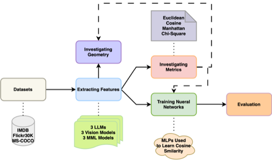

# Cross-modal Feature Alignment

Research code for **Multimodal Representation Alignment for Cross-modal Information Retrieval** by Fan Xu and Luis A. Leiva ([paper, arXiv:2506.08774v2](https://arxiv.org/abs/2506.08774v2)).

This repository studies how image and text representations relate geometrically and how well they support cross-modal retrieval. It compares fixed similarity/distance metrics with learned pairwise scoring networks on IMDB, Flickr30K, and MS-COCO. The learned networks operate on extracted embeddings; they do not fine-tune the feature encoders.

## Experimental pipeline



**Figure 1. Experimental pipeline.** Image–text pairs from three datasets are encoded with three vision-language models or three pairs of separately pretrained vision and language encoders. The resulting embeddings support geometric analysis, retrieval with fixed metrics (Euclidean, cosine, Manhattan, and Chi-square), and learned pairwise scoring. The revised paper evaluates both MLP and transformer-based fusion networks with MSE and a custom contrastive objective, followed by text-to-image and image-to-text retrieval evaluation. The figure's “MLPs Used to Learn Cosine Similarity” label depicts the original regression branch; the revised experiments extend this branch to both architectures and objectives.

## Models and datasets

The six encoder configurations used in the paper map to these script identifiers:

| Configuration | `model_name` | Embedding dimension per modality in the extractor |
| --- | --- | --- |
| CLIP ViT-B/32 | `clip` | 512 |
| BLIP base retrieval COCO | `blip_official_itm` | 256 |
| Meta-Transformer B/16 | `metatransformer` | 768 |
| ResNet-34 / BERT-small | `resnetbert` | 512 |
| ConViT-base / RoBERTa-base | `convitroberta` | 768 |
| ConvNeXt-small / XLNet-base-cased | `convnextxlnet` | 768 |

Other BLIP variants in `feature_extractor.py` are exploratory options. Use `blip_official_itm` for the retrieval checkpoint described in the paper. The table reports the current extractor's dimensions; the paper's Appendix A lists BLIP as 512-dimensional, so that entry differs from this implementation.

| Dataset | Script identifier | Image–text pairing |
| --- | --- | --- |
| IMDB Vision and NLP | `imdb` | Movie poster and title; approximately 4K pairs |
| Flickr30K | `flickr30k` | Image and its first caption |
| MS-COCO Train2017 | `coco_train` | Image and its first caption |

The experiments assume one ground-truth match per query. For learned scoring, `train_main.py` uses all available IMDB pairs and selects up to 20K pairs for each other dataset. It splits paired rows into 80% training, 10% validation, and 10% testing. The command-line entry point sets the PyTorch random seed to 0. Fixed-metric experiments in `compute_distance.py` use a separate random subset of up to 1K pairs; their candidate pools differ from the learned models' test sets.

## Setup

Use a Python environment with a recent PyTorch release supporting `torch.load(..., mmap=True, weights_only=True)`. Install a PyTorch build appropriate for your CPU or CUDA environment, then install the dependencies for training on existing embeddings:

```bash
python -m pip install torch matplotlib scikit-learn torchmetrics tqdm
```

Feature extraction and the optional analysis scripts additionally use `torchvision`, `transformers`, `timm`, `torchextractor`, `Pillow`, `pandas`, `webdataset`, `numpy`, `scipy`, `seaborn`, `umap-learn`, `geomloss`, `captum`, `datasets`, and `optuna`, depending on the script. Dependency versions are not pinned in this repository. The local ConViT and ConvNeXt code uses older `timm` import paths, so extraction may require version adjustments.

Datasets, extracted embeddings, pretrained weights, and trained checkpoints are not included. Obtain datasets and encoder checkpoints separately before running their corresponding stages.

## Prepare embeddings

Training expects two PyTorch tensors of shape `[N, D]`, with equal dimensions and row-aligned image–text matches. Store them using this layout, where model directories are uppercase and filenames are lowercase:

```text
alignment_features/
└── CLIP/
    ├── clip_caption_embed_imdb.pt
    └── clip_img_embed_imdb.pt
```

The general filenames are:

```text
<feature_root>/<MODEL_NAME>/<model_name>_caption_embed_<dataset>.pt
<feature_root>/<MODEL_NAME>/<model_name>_img_embed_<dataset>.pt
```

`feature_extractor.py` contains the extraction routines, and `load_data.py` contains dataset loaders. These scripts retain paths from the original compute environment and require configuration before use:

- Update dataset paths in `load_data.py` and the image roots used by `FeatureExtractor.load_dataset`. IMDB expects `movies.csv` with `local_image_path` and `Title` columns plus an `images/` directory. Flickr30K expects `results.csv` with `image_name`, `comment_number`, and `comment` columns plus `flickr30k_images/`. MS-COCO expects caption annotation files and train/validation image directories.
- Populate `BLIP_Official/` with the upstream BLIP source and configure its import path. The repository records external source directories as Git links but has no `.gitmodules` configuration, so a normal clone does not populate them.
- For Meta-Transformer, supply the Data2Seq implementation and encoder checkpoint, restore the Data2Seq import, and enable the currently disabled extraction branch. Its checkpoint path is defined in `metatransformer_arch.py`.
- The extractor initializes a CUDA/NCCL process group and must run under `torchrun`. Its current `__main__` block inspects saved Flickr30K features; enable `get_features(args.which_dataset, store_path=args.store_path)` to perform extraction instead.

Once configured and with the extraction call enabled, a single-GPU launch has this form:

```bash
torchrun --standalone --nnodes=1 --nproc-per-node=1 \
  feature_extractor.py clip imdb --batch_size 64 --store_path /path/to/data
```

This writes embeddings below `/path/to/data/alignment_features/CLIP/`. Alternatively, supply your own paired embeddings in the format above and proceed directly to training.

## Train and evaluate

**`train_main.py` is the main entry point for both MLPs and transformer-based fusion networks.** Run commands from the repository root. Set `--path` to your feature root; the original default is `/data/data_fxu/alignment_features/`.

Train the MLP architecture described in the revised paper:

```bash
python train_main.py clip imdb \
  --path /path/to/alignment_features \
  --network new_mlp --loss_func contrastive --task txt2img \
  --batch_size 64 --n_epochs 100 --lr 5e-5 --gpu_id 0
```

Train the transformer fusion network:

```bash
python train_main.py clip imdb \
  --path /path/to/alignment_features \
  --network transformer --loss_func contrastive --task img2txt \
  --batch_size 64 --n_epochs 100 --lr 5e-5 --gpu_id 0
```

Use `--loss_func mse` for cosine-similarity regression, and change `model_name` and `dataset` to select another embedding set. `--task txt2img` retrieves images from text queries; `--task img2txt` reverses the query and candidate modalities. CUDA is used when available, otherwise training falls back to CPU.

| `--network` | Implementation in `NN.py` |
| --- | --- |
| `new_mlp` | Concatenated embeddings, hidden layers of 512 and 256 units, ReLU, dropout 0.1, and a scalar tanh output; the paper's MLP configuration |
| `transformer` | Separate projections to 128 dimensions, one bidirectional cross-attention block with 4 heads, feed-forward layers, dropout 0.1, and a scalar tanh output |
| `mlp` (default) | Earlier MLP variant with two 500-unit hidden layers, ReLU, and a scalar tanh output |

Each training batch contains matched embedding rows. The trainer scores all `B × B` query–candidate combinations:

- **MSE:** regress the cosine similarity of each input pair, including off-diagonal pairs.
- **Custom contrastive loss:** move matched diagonal scores toward `+1` and unmatched off-diagonal scores toward `−1`, averaging the positive and negative groups separately so negatives do not dominate. `CustomContrastiveLossBalanced` in `contrastive.py` sums these two group means; Equation 5 in the paper additionally averages them by a factor of 1/2. This constant changes the loss scale but not its minimizer. Use batches containing at least two pairs for this objective.

The optimizer is Adam with cosine annealing from the selected learning rate to `1e-7`. Early stopping is disabled by default; enable it with `--early_stopping True` and configure `--patience` and `--tolerance`. The CLI tolerance default is `1e-6`.

Training automatically evaluates the final in-memory model on its held-out test split and prints **Recall@1, Recall@5, and Recall@10**. It scores each test query against every test candidate in chunks, then constructs the full score matrix. Pair scoring scales quadratically with batch size during training and with test-set size during evaluation.

Checkpoints, loss histories, and loss plots are saved under:

```text
<feature_root>/<MODEL_NAME>/model_checkpoints/<network>_<dataset>_<loss_func>_<task>/
```

Checkpoints and histories are saved every five epochs and when early stopping triggers. Evaluation uses the final model rather than automatically reloading the best validation checkpoint. Re-running the same network/dataset/loss/task combination clears files in that output directory, so copy any results you want to retain first.

## Fixed-metric retrieval and analysis

`compute_distance.py` evaluates Euclidean, cosine, Manhattan, and Chi-square metrics. It currently uses the original feature root in the source; adjust `ComputeDistance.path` for your environment. Its third positional argument is `yes` for text-to-image retrieval and `no` for image-to-text retrieval:

```bash
python compute_distance.py clip imdb yes --GPU_id 0
python compute_distance.py clip imdb no --GPU_id 0
```

`plot_features.py`, `plot_heatmap.py`, `plot_dist.py`, `plot_examples.py`, and `plot_precision_decline.py` support embedding-space and retrieval analyses. `hyperparam_tuning.py` provides exploratory Optuna tuning. These scripts contain experiment-specific paths and settings that should be reviewed before execution.

The paper finds cosine similarity to be a strong retrieval baseline, especially for contrastively pretrained CLIP and BLIP. The custom contrastive objective generally improves learned alignment over MSE, particularly for initially unaligned representations, although transformer results vary by dataset. A small modality gap alone does not guarantee strong retrieval; the paper also examines Wasserstein distance as a complementary distributional measure. See the paper for complete tables and interpretation.

## Repository organization

| File or directory | Purpose |
| --- | --- |
| `train_main.py` | Shared training, validation, checkpointing, and retrieval evaluation |
| `NN.py` | MLP and transformer fusion architectures |
| `contrastive.py` | Custom contrastive objectives |
| `feature_extractor.py`, `load_data.py` | Encoder feature extraction and paired dataset loading |
| `compute_distance.py` | Fixed-metric retrieval baselines |
| `feature_processing.py`, `hyperparam_tuning.py` | Earlier feature-processing and tuning utilities |
| `figures/pipeline.png` | Pipeline illustration retained for this README |
| `scripts/` (local, ignored) | Bash launchers collected from the original repository |

`transformer_train.py` is an earlier training variant. Use `train_main.py` for training and its integrated retrieval evaluation.

Local bash launchers, log directories, generated figures other than `figures/pipeline.png`, metric-output directories (`bray_curtis`, `canberra`, `chi_square`/`chi_squre`, `cosine`, `manhattan`, `euclidean`), `discarded_files`, `clean_code`, and `plot_centroid_info` are excluded from Git. Ignored artifacts may remain in an existing local checkout, but are not distributed by a fresh clone.

## Citation

```bibtex
@misc{xu2026multimodal,
  title         = {Multimodal Representation Alignment for Cross-modal Information Retrieval},
  author        = {Fan Xu and Luis A. Leiva},
  year          = {2026},
  eprint        = {2506.08774},
  archivePrefix = {arXiv},
  primaryClass  = {cs.IR},
  url           = {https://arxiv.org/abs/2506.08774v2}
}
```
